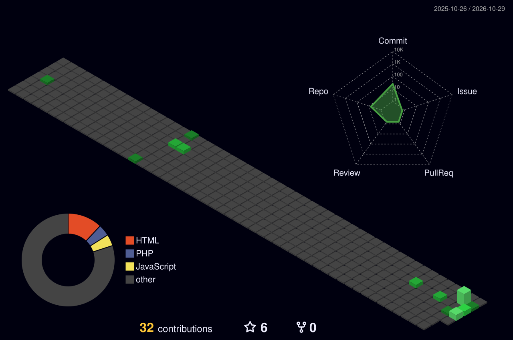

# Hi, I'm G-tech 👋

💻🚀 Aspiring Software Developer | 🌱 Always Learning

Welcome to my GitHub profile! I'm an IT student passionate about software development, web technologies, and solving real-world problems through code. I'm continuously improving my skills, building projects, and exploring new technologies.

## 📊 My GitHub Activity

## My Contributions 

## 🧊 My 3D Contributions

## 🛠️ Technologies & Tools

### 💻 Programming Languages

### 🌐 Web Development

### 🗄️ Databases

### ⚙️ Tools & Platforms

## Current Goals

   -Expand my programming and software development skills
  -Build practical projects and a strong portfolio
  -Improve my problem-solving and technical skills
  - Collaborate with other developers
  - Complete my IT degree and prepare for a career in tech

## 📫 Connect With Me

  - GitHub: [oirigagilbert05-bot](https://github.com/oirigagilbert05-bot)

---

⭐ Thanks for visiting my profile! Feel free to explore my repositories and follow my journey.
