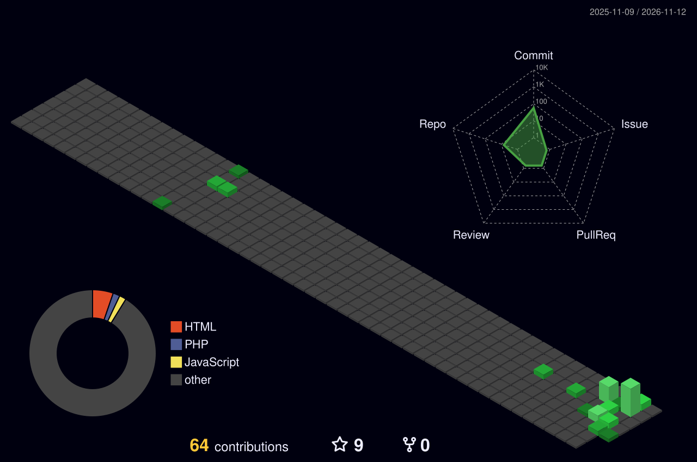

<!-- ======================================= -->
<!--             G-TECH PROFILE              -->
<!-- ======================================= -->

<div align="center">


<h3>💻 Aspiring Software Developer | 🚀 Tech Enthusiast |  Lifelong Learner</h3>


</div>

---

## 👨‍💻 About Me

Hello! I'm **G-tech**, an IT student passionate about software development, programming, and technology.

I enjoy turning ideas into practical solutions through code. I'm continuously learning, experimenting with new technologies, and building projects that solve real-world problems.

- 🎓 IT Student
- 💻 Aspiring Software Developer
- 🌱 Currently improving my programming skills
- 🔭 Exploring Web Development and Software Engineering
- 🚀 Interested in building innovative projects
- 🤝 Open to collaboration and learning opportunities
- 🎯 Goal: Become a skilled professional software developer

---

## 🛠️ Tech Stack & Tools

### 💻 Programming Languages

<p align="left">

</p>

### 🌐 Web Development

<p align="left">

</p>

### 🗄️ Databases

<p align="left">

</p>

### ⚙️ Tools & Platforms

<p align="left">

</p>

---

## 📊 GitHub Statistics

<div align="center">


</div>

---

## 🔥 GitHub Streak

<div align="center">


</div>

---

## 🐍 Contribution Snake

<div align="center">


</div>

---

## 🧊 3D GitHub Contributions

<div align="center">



</div>

---

## 🚀 Featured Projects

Here are some projects I'm working on and developing.

<!-- Replace these examples with your real project repository names and descriptions -->

<div align="center">

<a href="https://github.com/oirigagilbert05-bot">

</a>

</div>

> 💡 Replace `REPOSITORY_NAME` with the name of an existing repository.

---

## 🎯 Current Goals

- [ ] Improve my problem-solving skills.
- [ ] Build practical software development projects.
- [ ] Master modern web development technologies.
- [ ] Contribute to open-source projects.
- [ ] Learn advanced programming concepts.
- [ ] Build a professional developer portfolio.
- [ ] Collaborate with other developers.

---

## 📈 My Developer Journey

```text
Learning       ██████████░░  Growing
Building       ████████░░░░  In Progress
Problem Solving ███████░░░░░ Improving
Collaboration  ██████░░░░░░  Growing
```

---

## 🤝 Connect With Me

<div align="center">

<a href="https://github.com/oirigagilbert05-bot">

</a>

<!-- Add your real LinkedIn URL below -->
<a href="https://www.linkedin.com/">

</a>

<!-- Replace with your professional email -->
<a href="mailto:YOUR_EMAIL@gmail.com">

</a>

</div>

---

<div align="center">

### 💚 Code. Learn. Build. Repeat.

**"Great developers are not born; they are built through curiosity, consistency, and practice."**

⭐ Thanks for visiting my profile!


</div>
